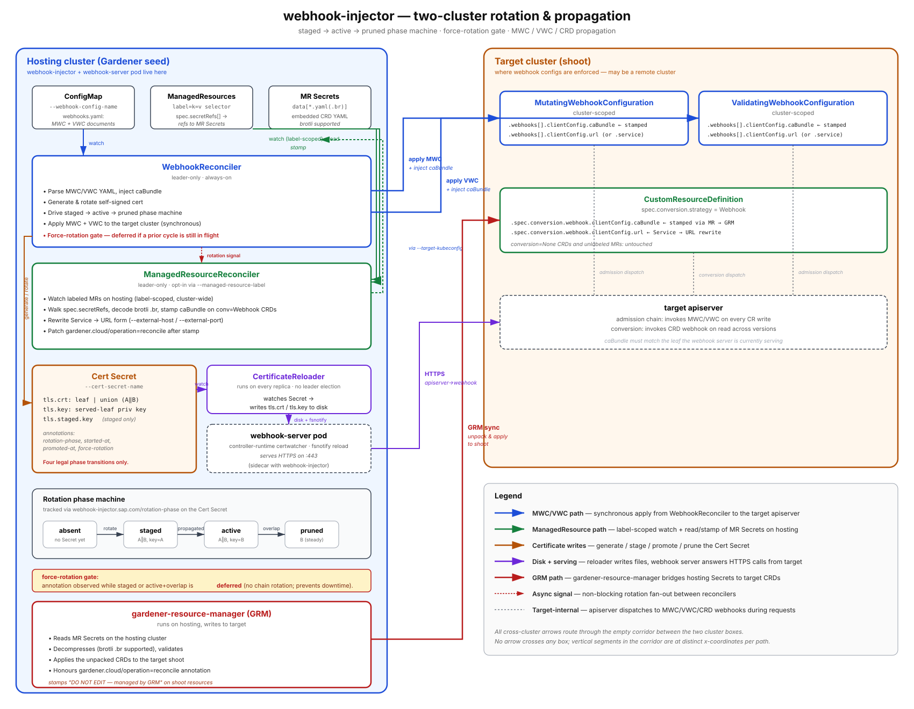
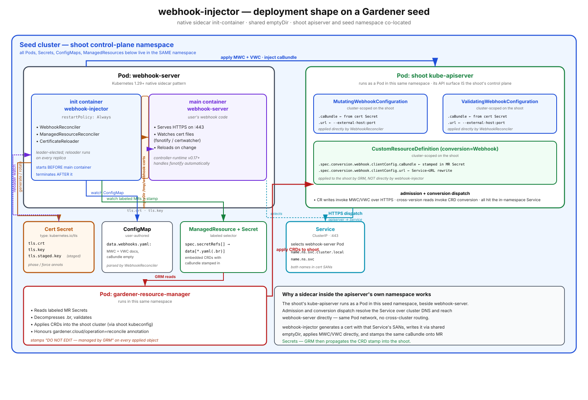

<!--
SPDX-FileCopyrightText: 2026 SAP SE or an SAP affiliate company

SPDX-License-Identifier: Apache-2.0
-->

# webhook-injector

A Kubernetes controller that runs as a sidecar to webhook servers, managing webhook configurations and TLS certificates for remote or local clusters.

## Features

- **Automatic Certificate Management**: Generates and rotates self-signed certificates with dynamic SANs.
- **Smart Rotation**: Time-based (20% remaining validity threshold), config-based (SAN changes), or manual (annotation).
- **Remote Cluster Support**: Manage webhooks in clusters where the webhook server doesn't run.
- **Language Agnostic**: Works with any webhook server that can watch certificate files for changes.
- **High Availability**: Leader election with multi-replica support, zero-downtime rotation.
- **Zero-downtime certificate rotation**: staged overlap — both old and new certs trusted on the target cluster before the new one is served, then the old cert is pruned after a configurable grace window.
- **Gardener Seed Support**: Stamps CRDs at the source — inside Gardener `ManagedResource` Secrets on the seed — so the stamp survives `gardener-resource-manager`'s next sync into the shoot.

## Architecture



webhook-injector runs as a sidecar with up to three controllers:

- **WebhookReconciler** (leader only): Watches a user-authored ConfigMap that carries `MutatingWebhookConfiguration` / `ValidatingWebhookConfiguration` YAML, manages the certificate Secret on the hosting cluster, injects the CA bundle, and applies the resulting MWC/VWC to the target cluster (creating if missing). Does not author CRDs — those flow through `ManagedResource` objects.
- **ManagedResourceReconciler** (leader only, opt-in via `--managed-resource-label`): Watches labeled Gardener `ManagedResource` objects on the hosting cluster and stamps `caBundle` (and optionally rewrites Service-form conversion `clientConfig` to URL form) on every CRD embedded in their referenced Secrets. See [Gardener Seed Deployment](#gardener-seed-deployment).
- **CertificateReloader** (all replicas): Syncs certificates from Secret to local filesystem (`/tmp/webhook-certs`). Skips writes when content is unchanged.

### Remote Cluster Architecture

```
┌────────────────────────────────────────────────────────────────────────┐
│ Hosting Cluster (where webhook server runs)                            │
│                                                                        │
│  ┌──────────────────────────────────────────────────────────────────┐  │
│  │ Pod: webhook-server                                              │  │
│  │                                                                  │  │
│  │  ┌──────────────────┐      ┌──────────────────────────────────┐  │  │
│  │  │ webhook-server   │◄─────┤ webhook-injector (sidecar)       │  │  │
│  │  │                  │ certs│                                  │  │  │
│  │  │ Serves webhooks  │      │ ┌─────────────────────────────┐  │  │  │
│  │  │ on :9443         │      │ │ • Watches ConfigMap         │  │  │  │
│  │  └──────────────────┘      │ │ • Generates certs           │  │  │  │
│  │           ▲                │ │ • Updates Secret            │  │  │  │
│  │           │                │ │ • Reloads certs to disk     │  │  │  │
│  │           │                │ │ • Applies MWC/VWC to target │  │  │  │
│  │           │                │ │   cluster                   │  │  │  │
│  │           │                │ └─────────────────────────────┘  │  │  │
│  │           │                │         ▲           │            │  │  │
│  │           │                └─────────┼───────────┼────────────┘  │  │
│  │           │                          │           │               │  │
│  └───────────┼──────────────────────────┼───────────┼───────────────┘  │
│              │                          │           │                  │
│              │                      watches      updates               │
│              │                          │           │                  │
│              │                          │           ▼                  │
│              │                    ┌─────┴─────┐ ┌─────────┐            │
│              │                    │ ConfigMap │ │ Secret  │            │
│              │                    │ webhook   │ │ certs   │            │
│              │                    │ configs   │ └─────────┘            │
│              │                    └───────────┘                        │
└──────────────┼─────────────────────────────────────────────────────────┘
               │                           │
               │                           │ applies webhook configs
               │                           │
               │                           ▼
               │   ┌─────────────────────────────────────────────────────┐
               │   │ Target Cluster (remote - where webhooks enforced)   │
               │   │                                                     │
               │   │  ┌─────────────────────────────────────────────┐    │
               │   │  │ MutatingWebhookConfiguration                │    │
               │   │  │ ValidatingWebhookConfiguration              │    │
               │   │  │                                             │    │
               │   │  │ clientConfig:                               │    │
               │   │  │   url: https://webhook...                   │    │
               │   │  │   caBundle: <injected>                      │    │
               │   │  └─────────────────────────────────────────────┘    │
               │   │             │                                       │
               │   │             │ API Server calls webhook URL          │
               │   │             │ (validates against caBundle)          │
               │   └─────────────┼───────────────────────────────────────┘
               │                 │
               │                 │
               └─────────────────┘
```

## Quick Start

### Prerequisites

- Go 1.26+
- Kubernetes 1.29+ (for native sidecar support)
- kubectl configured
- (Optional) Target cluster kubeconfig if managing remote cluster
- **Webhook server requirement**: Must watch certificate files and reload on changes (controller-runtime v0.17+ does this automatically)

### Build

```bash
make build
```

### Sidecar Deployment

webhook-injector is deployed as a [native sidecar](https://kubernetes.io/docs/concepts/workloads/pods/sidecar-containers/) (Kubernetes 1.29+). Native sidecars are init containers with `restartPolicy: Always` — they start before and terminate after the main containers, which guarantees certificates are written to disk before the webhook server starts.

```yaml
apiVersion: apps/v1
kind: Deployment
metadata:
  name: webhook-server
spec:
  replicas: 3
  template:
    spec:
      initContainers:
        - name: webhook-injector
          image: webhook-injector:latest
          restartPolicy: Always
          args:
            - --webhook-config-name=webhook-config
          startupProbe:
            httpGet:
              path: /readyz
              port: 8083
            initialDelaySeconds: 5
            periodSeconds: 5
            failureThreshold: 6
          volumeMounts:
            - name: webhook-certs
              mountPath: /tmp/webhook-certs
      containers:
        - name: webhook-server
          image: my-webhook:latest
          volumeMounts:
            - name: webhook-certs
              mountPath: /tmp/webhook-certs
              readOnly: true
      volumes:
        - name: webhook-certs
          emptyDir: {}
```

> **Kubernetes < 1.29:** If you need to support older clusters, place `webhook-injector` in `containers` instead of `initContainers` and remove the `restartPolicy` field. The tradeoff is that the webhook server may start before certificates are available, so its `initialDelaySeconds` must account for certificate generation time.

Create a ConfigMap with webhook definitions (standard Kubernetes webhook YAML):

```yaml
apiVersion: v1
kind: ConfigMap
metadata:
  name: webhook-config
data:
  webhooks.yaml: |
    apiVersion: admissionregistration.k8s.io/v1
    kind: MutatingWebhookConfiguration
    metadata:
      name: my-webhook
    webhooks:
      - name: mutate.example.com
        clientConfig:
          service:              # or url: for remote clusters
            name: webhook-service
            namespace: default
            path: /mutate
          caBundle: ""          # Injected automatically
        # ... standard webhook config
```

**Note:** Your webhook server must watch the certificate directory and reload certificates when `tls.crt` or `tls.key` change. Controller-runtime webhook servers (v0.17+) provide this functionality automatically via an internal `certwatcher`. For other frameworks, implement file watching using inotify/fsnotify or periodic polling.

## Certificate Management

**Rotation triggers:**
1. Time-based: When remaining validity < threshold × total (default: 20%, i.e., 18 days of a 90-day cert)
2. Config-based: When webhook service references or URLs change (new SANs required)
3. Manual: Annotate Secret with `webhook-injector.sap.com/force-rotation: "true"`

**Certificate output** (`/tmp/webhook-certs`):
- `tls.crt`: Self-signed certificate with SANs from service/URL references. During rotation this is a concatenated PEM bundle of the old + new certs (`old || new`) — consumers must tolerate multiple PEM blocks. After the overlap window elapses it reduces back to a single cert.
- `tls.key`: Private key for the leaf currently being served. Flipped to the new key at the `staged→active` transition.

The same certificate serves as both server cert and CA bundle. Your webhook server must reload these files when they change — controller-runtime webhook servers (v0.17+) handle this automatically via fsnotify.

**Zero-downtime rotation (staged→active→pruned).** Rotation is a phase machine recorded on the cert Secret via `webhook-injector.sap.com/rotation-phase` (`staged|active`, absent = steady) and `webhook-injector.sap.com/rotation-started-at` (RFC3339). In `staged`, the new cert is appended to `tls.crt` while `tls.key` still serves the old cert; the new key lives in `tls.staged.key`. The controller polls the auto-discovered gate set (every CRD `ManagedResourceReconciler` stamped on its most recent pass, published via the in-memory `*rotationgate.Gate` it shares with `WebhookReconciler`) on the target cluster, or waits up to `--rotation-gate-timeout`, for the union caBundle to land — then flips `tls.key` to the staged key (`active`). After `--rotation-overlap-window` the old cert is pruned. Pure-ConfigMap deployments (no `--managed-resource-label`) have no MR reconciler, so the gate snapshot stays empty and the rotation falls through to the time-based timeout alone — correct, because those deployments write MWC/VWC directly to the target cluster via synchronous Apply and have no GRM hop to wait on. RBAC: the target-cluster ClusterRole grants `get,list,watch` on `customresourcedefinitions.apiextensions.k8s.io` to drive the gate.

## Configuration

Configure via command-line flags. `--webhook-config-name` is **required**; namespace auto-detects from flag → `NAMESPACE` env var → serviceaccount file.

| Flag | Description | Default |
|------|-------------|---------|
| `--webhook-config-name` | **Required.** ConfigMap (in `--namespace`, hosting cluster) carrying a `webhooks.yaml` key whose value contains the MWC/VWC YAML to apply to the target cluster. CRDs are not handled here — see `--managed-resource-label`. | *required* |
| `--managed-resource-label` | Label selector (`key=value`) used to scope the Gardener `ManagedResource` reconciler on the hosting cluster. When set, the controller watches labeled MRs, walks their referenced Secrets, finds embedded CRDs with `conversion.strategy=Webhook`, and stamps `caBundle` (and optionally rewrites Service-form `clientConfig` to URL form). When unset, the reconciler is not registered. | unset |
| `--external-host` | **Required when `--managed-resource-label` is set.** DNS name or IP (no port) the target cluster uses to reach this controller. Combined with `--external-port` to rewrite Service-form conversion `clientConfig` inside MR-embedded CRDs to `https://<external-host>:<external-port><Service.Path>` (path defaults to `/`); URL-form entries are left untouched. `caBundle` patching is unchanged. Ignored when `--managed-resource-label` is unset. | unset |
| `--external-port` | **Required when `--managed-resource-label` is set.** External port the target cluster uses to reach the labeled webhook callbacks. | unset |
| `--force-reconcile` | When `--managed-resource-label` is set, patch `gardener.cloud/operation=reconcile` on each ManagedResource after a successful Secret stamp so `gardener-resource-manager` picks up the change promptly. The annotation is set only on reconciles that actually wrote a Secret. | `true` |
| `--cert-sans` | Comma-separated DNS names and/or IP addresses to include as additional certificate SANs (merged with SANs derived from the ConfigMap). | unset |
| `--rotation-overlap-window` | Duration the controller keeps the old cert in `tls.crt` after promoting the new serving cert. Set ≥ longest expected in-flight TLS session. | `5m` |
| `--rotation-gate-timeout` | Max time to wait for shoot CRDs to show the union bundle during the staged phase. On timeout the controller promotes anyway (working webhook beats stuck rotation). The gated CRD set is auto-discovered from `ManagedResourceReconciler`'s most recent reconcile pass (see `pkg/controllers/rotationgate`); an empty snapshot — pure-ConfigMap deployments, or no labeled MRs shipping CRDs — collapses the gate to this timeout alone. | `2m` |
| `--namespace` | Namespace for ConfigMap / Secret / Lease | auto-detect |
| `--cert-secret-name` | Secret for certificates | `webhook-injector-certs` |
| `--cert-dir` | Certificate output directory | `/tmp/webhook-certs` |
| `--cert-validity` | Certificate lifetime (e.g., `2160h`, `90d`) | `2160h` |
| `--cert-rotation-threshold` | Rotation threshold (0-1) | `0.2` |
| `--target-kubeconfig` | Target cluster kubeconfig path | in-cluster |
| `--enable-leader-election` | Enable HA mode | `true` |
| `--leader-election-id` | Lease name | `webhook-injector-leader` |
| `--sync-period` | Reconciliation interval | `5m` |
| `--metrics-addr` | Metrics bind address | `:8082` |
| `--health-addr` | Health probe address | `:8083` |
| `--version` | Print version and exit | — |

**Example — ConfigMap mode only:**

```bash
webhook-injector --webhook-config-name=my-config
```

**ConfigMap mode + Gardener ManagedResource stamping:**

```bash
webhook-injector \
  --webhook-config-name=my-config \
  --managed-resource-label=webhook-injector/name=cert-manager \
  --external-host=webhook.example.com \
  --external-port=9443
```

`--external-host` + `--external-port` rewrite every CRD entry inside an MR Secret whose `clientConfig.Service` is set: the Service is replaced with `clientConfig.URL = https://<external-host>:<external-port><Service.Path>` (Service.Path nil/empty → `/`). Entries that already use URL-form `clientConfig` are left untouched. `caBundle` is patched as usual. These flags do not affect SAN generation — extra SANs are configured via `--cert-sans`.

### Gardener Seed Deployment



When webhook-injector runs on a Gardener seed, the CRDs it must stamp don't live directly in the shoot apiserver — they are wrapped inside `ManagedResource` objects on the seed, and `gardener-resource-manager` (GRM) reconciles them into the shoot. Stamping the shoot-side CRD directly would produce a thrash loop: GRM would overwrite the stamp on its next sync from the (unstamped) Secret on the seed.

`--managed-resource-label` enables `ManagedResourceReconciler`, which stamps the CRDs at the source — the `ManagedResource`'s referenced Secret on the hosting cluster — so the stamp survives GRM's next sync. The reconciler:

- Watches labeled `ManagedResource` objects across all seed namespaces (one shoot per namespace), filtered by `--managed-resource-label`.
- For each ManagedResource walks `spec.secretRefs[*]`, decodes each Secret data key (including [brotli](https://www.gardener.cloud/docs/gardener/concepts/resource-manager/#compression)-compressed `.br`-suffixed keys GRM produces for large payloads), finds CRDs with `conversion.strategy=Webhook`, and rewrites their `clientConfig`. Non-CRD documents in the same Secret survive byte-for-byte.
- Only writes the Secret back when a CRD actually changed — no-op reconciles do not bump `resourceVersion`, otherwise GRM would re-apply on every sync and re-trigger this loop.
- By default also patches `gardener.cloud/operation=reconcile` on the ManagedResource (controlled by `--force-reconcile`, default `true`) so GRM picks up the change promptly even if it is in backoff. The annotation is set only on reconciles that actually wrote a Secret.
- Observes the GRM-maintained `ResourcesApplied` and `ResourcesHealthy` conditions on each ManagedResource and logs/counts when either is not `True`, surfacing MR health on dashboards without gating the stamp on it.
- Enforces a `spec.keepObjects: true` invariant on MRs that ship CRDs and emits a warning-level log (no stack trace) plus a counter when it's missing — the counter is the alertable signal. Without `keepObjects`, deleting the ManagedResource would cascade-delete the shoot's CRDs and every custom resource of those kinds.

```
┌─────────────────────────────────────────────────────────────────────┐
│ Gardener Seed (hosting cluster)                                     │
│                                                                     │
│  ┌──────────────────┐         ┌────────────────────────────────┐    │
│  │ webhook-injector │ stamps  │ ManagedResource <shoot-ns>     │    │
│  │ (sidecar)        ├────────►│   spec.secretRefs: [crds]      │    │
│  │                  │ caBundle│   spec.keepObjects: true       │    │
│  │ +ManagedResource │         │ Secret: crds (CRDs inside)     │    │
│  │  Reconciler      │         └───────────────┬────────────────┘    │
│  └──────────────────┘                         │                     │
│                                               │ GRM syncs           │
└───────────────────────────────────────────────┼─────────────────────┘
                                                │
                                                ▼
                                  ┌─────────────────────────────┐
                                  │ Shoot (target cluster)      │
                                  │   CRDs with stamped         │
                                  │   conversion clientConfig   │
                                  └─────────────────────────────┘
```

## Metrics

webhook-injector exposes Prometheus metrics at `<metrics-addr>/metrics` (default `:8082`). All metric names are prefixed `webhook_injector_`.

| Metric | Type | Description |
|---|---|---|
| `certificate_rotations_total` | Counter | Certificate rotations by `reason` label: `initial`, `expired`, `san_mismatch`, `force_rotation` |
| `certificate_expiry_time_seconds` | Gauge | Unix timestamp when the current TLS certificate expires |
| `cert_files_written_total` | Counter | Times certificate files were written to disk by the reloader |
| `certificate_rotation_phase_transitions_total{from,to}` | Counter | Rotation phase-machine transitions; labels drawn from {absent, active, staged, pruned}. Five legal pairs (absent→active, active→staged, staged→staged, staged→active, active→pruned); any other pair indicates a controller bug |
| `target_stamps_total{kind,result}` | Counter | Target-cluster MWC/VWC apply outcomes by `kind` (MutatingWebhookConfiguration, ValidatingWebhookConfiguration) and `result` (stamped, converged, error) |
| `rotation_fanout_events_total{kind,outcome}` | Counter | Rotation fan-out events to the ManagedResource reconciler, by `kind=ManagedResource` and `outcome` (emitted, dropped) |
| `managed_resource_stamps_total{result}` | Counter | Per-MR reconcile outcomes (stamped, converged, error) |
| `managed_resource_crds_stamped_total` | Counter | Per-CRD-document stamp count across all MR Secrets |
| `managed_resource_secret_keys_total{encoding}` | Counter | Secret data keys processed by encoding (plain, brotli) |
| `managed_resource_force_reconcile_total{result}` | Counter | `gardener.cloud/operation=reconcile` annotation patches by result (patched, skipped, error) |
| `managed_resource_keep_objects_violations_total` | Counter | Labeled MR reconciles that ship CRDs without `spec.keepObjects=true` |
| `managed_resource_unhealthy_total{condition,status}` | Counter | MRs whose `ResourcesApplied`/`ResourcesHealthy` is present and not `True` |

Standard controller-runtime metrics (reconcile latency, queue depth, etc.) are also included.

## Testing

```bash
# Unit tests
gmake test

# E2E integration tests (creates kind clusters, tests multi-cluster setup)
gmake test-e2e

# Manual E2E workflow
gmake e2e-setup      # Create hosting + target kind clusters
gmake e2e-dev        # Skaffold dev mode with hot reload
gmake e2e-teardown   # Cleanup
```

E2E tests validate multi-cluster architecture, HA with 3 replicas, leader election, load balancing, and zero-downtime certificate rotation under continuous load. See [test/e2e/README.md](test/e2e/README.md) for details.

## Development

```bash
make build           # Build binary
make check           # Run all checks (MUST pass before commit)
make static-check    # Linters only
golangci-lint run --fix  # Auto-fix lint issues

# Docker
make docker-build

# Deployment
kubectl apply -k config/  # Deploy from config/ manifests
```

**Note:** Use `gmake` on macOS (built-in make is too old). All Go files must have Apache-2.0 license headers (auto-added by addlicense).

## License

Apache 2.0
